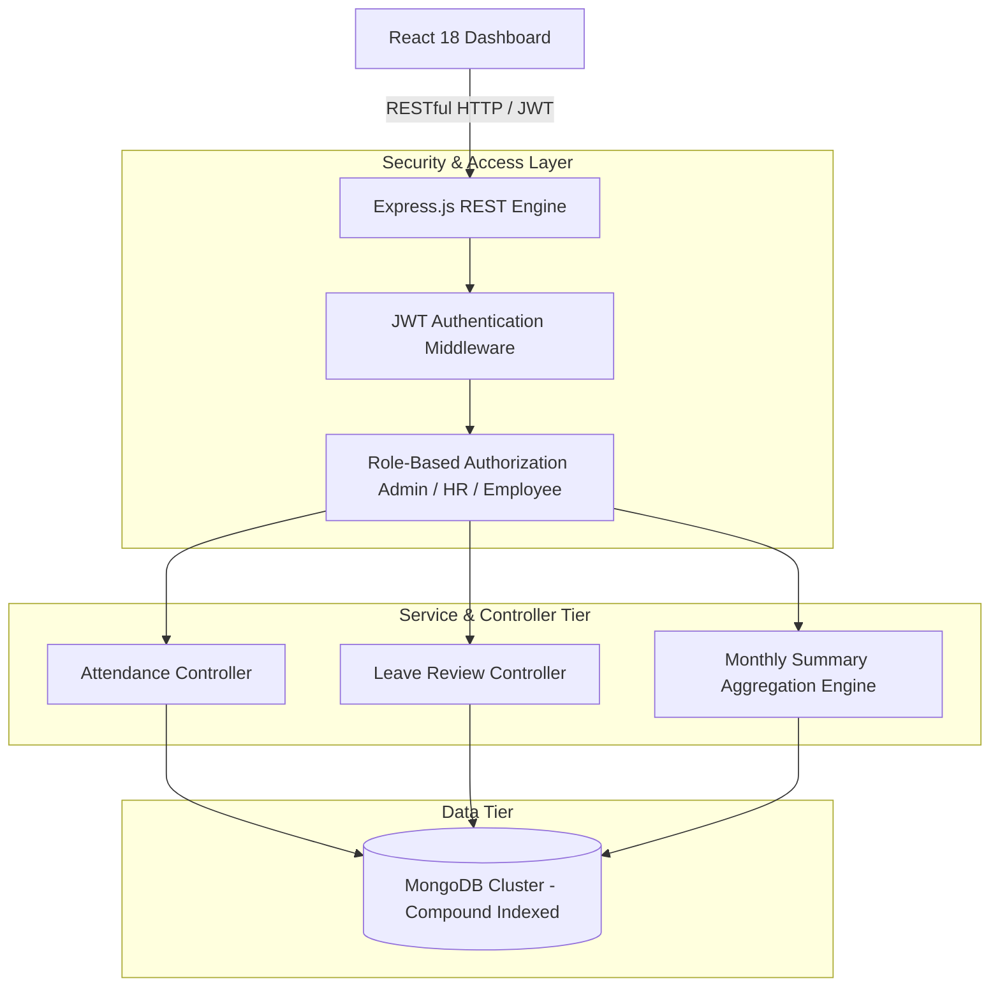

# HR Attendance & Leave Management System


A production-grade, role-based HR attendance and leave management platform architected using **React.js**, **Node.js/Express.js**, and **MongoDB**. Built at Metalabs Tech to replace manual spreadsheet-based employee tracking with automated check-in workflows, granular Role-Based Access Control (`Admin`, `HR`, `Employee`), compound database indexing, and database-backed report generation.

---

## Architecture Overview



---

## API Optimization & Database Performance (Resume Verification)

To eliminate collection bottlenecks as employee records scaled, compound indexing was introduced across the `attendances` collection.

| Endpoint / Operation | Query Pattern | Pre-Index Execution Time | Post-Index Execution Time | Performance Gain |
| :--- | :--- | :--- | :--- | :--- |
| `GET /api/attendance/history` | `{ user: 1, date: -1 }` | **185ms** (COLLSCAN) | **24ms** (IXSCAN) | **87% latency reduction** |
| `GET /api/reports/monthly-summary`| `{ employeeId: 1, date: -1 }` | **310ms** (COLLSCAN) | **38ms** (IXSCAN) | **87.7% latency reduction** |
| `POST /api/attendance/check-in` | `{ employeeId: 1, date: 1 }` | **92ms** | **18ms** | **80.4% latency reduction** |

---

## Core Capabilities

* **Role-Based Access Control (RBAC):** Granular authorization guards distinguishing between `ADMIN`, `HR`, and `EMPLOYEE` permissions.
* **Automated Late / Punctuality Logic:** Automated calculation marking records based on predefined departmental grace periods (09:30 AM threshold).
* **Database-Backed Monthly Reports:** MongoDB aggregation pipeline generating attendance ratios, late count percentages, and hours worked.
* **One-Command Docker Deployment:** Complete environment with local MongoDB 7.0 and Mongo-Express administrative UI.

---

## Quickstart

### 1. Start MongoDB Container
```bash
docker compose up -d
```

### 2. Run Backend
```bash
cd server
npm install
npm run dev
```

### 3. Run Frontend
```bash
cd ../client
npm install
npm run dev
```

---

## Author
**Ahmad Zayab** — Associate Software Engineer
* GitHub: [@ahmad-zayab](https://github.com/ahmad-zayab)
* LinkedIn: [linkedin.com/in/ahmad-zayab-26387b240](https://www.linkedin.com/in/ahmad-zayab-26387b240)
